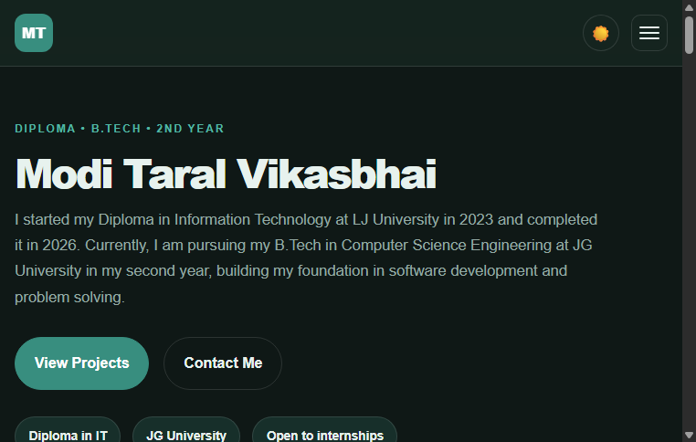

# Taral Modi - Personal Developer Portfolio

[](https://developer.mozilla.org/en-US/docs/Web/HTML)
[](https://developer.mozilla.org/en-US/docs/Web/CSS)
[](https://developer.mozilla.org/en-US/docs/Web/JavaScript)

A clean, modern, responsive personal developer portfolio website designed and developed from scratch using semantic **HTML5**, modern **CSS3**, and interactive **vanilla JavaScript**. 

This project is submitted as part of the **Web Technology Internal Assessment** (School of Engineering).

- 🔗 **GitHub Repository:** [https://github.com/TARAL1812/TaralModi_267143_Portfolio](https://github.com/TARAL1812/TaralModi_267143_Portfolio)
- 🌐 **Live Website Link (GitHub Pages):** [https://taral1812.github.io/TaralModi_267143_Portfolio/](https://taral1812.github.io/TaralModi_267143_Portfolio/)

---

## 📸 Portfolio Preview



---

## 👤 Student Information

- **Name:** Modi Taral Vikasbhai
- **Enrollment Number:** 2610442043
- **Roll Number:** 267143
- **Division:** DA
- **Program:** B.Tech Computer Science Engineering (Second Year)
- **Institution:** JG University

---

## 🌟 Key Features

1. **Semantic HTML5 Architecture:**
   - Structured using clean semantic HTML tags: `<header>`, `<nav>`, `<main>`, `<section>`, `<article>`, `<footer>`, and `<form>`.
   - Clear and accessible hierarchy with organized sections for *Hero*, *About*, *Skills*, *Education*, *Projects*, and *Contact*.

2. **Modern & Responsive CSS3:**
   - Pure CSS responsive layout utilizing **CSS Grid** and **Flexbox**.
   - Fluid typography and responsive spacing scaling gracefully from mobile screens up to desktop monitors.
   - Smooth hover transitions and interactive feedback on buttons, cards, and links.
   - Comprehensive media queries ensuring mobile-first responsive layout (`@media (max-width: 820px)`).

3. **Interactive JavaScript Features (`script.js`):**
   - 🌙 **Dark / Light Mode Switcher:** Smooth theme switching with preference persistence saved to browser `localStorage`.
   - 📱 **Mobile Navigation Menu:** Interactive mobile hamburger menu with smooth toggle states and auto-close on link navigation.
   - ✉️ **Client-Side Form Validation:** Real-time validation for the contact form ensuring valid email pattern, minimum name length, and required feedback alerts without reloading the page.
   - 📅 **Dynamic Copyright Year:** Automatic date synchronization in the footer.

---

## 🛠️ Technologies Used

- **HTML5:** Semantic document structure, clean accessibility tags, form input controls.
- **CSS3:** Custom CSS variables (theming), CSS Grid, Flexbox, media queries, CSS transitions.
- **JavaScript (ES6+):** DOM manipulation, event listeners (`click`, `submit`), `localStorage` API, regular expressions for input validation.

---

## 📂 Project Structure

```text
TaralModi_267143_Portfolio/
│
├── index.html              # Main HTML markup and structure
├── style.css               # Main styling rules, responsive layout & theme variables
├── styles.css              # Compatibility stylesheet alias
├── script.js               # Interactive JavaScript features (dark mode, nav, validation)
├── portfolio-preview.png   # Website preview screenshot
├── Copy of DSC01373.jpg    # Profile portrait photo
└── README.md               # Project documentation and details
```

---

## 🚀 Running the Project Locally

No dependencies or build steps are required. You can run the portfolio directly:

1. **Clone the repository:**
   ```bash
   git clone https://github.com/TARAL1812/TaralModi_267143_Portfolio.git
   ```
2. **Open the folder:**
   ```bash
   cd TaralModi_267143_Portfolio
   ```
3. **Launch in your browser:**
   - Double click `index.html` to open in any modern browser (Chrome, Edge, Firefox, Safari).
   - Or use VS Code Live Server extension.

---

## 📄 License & Integrity

This portfolio is an individual academic submission created solely by **Modi Taral Vikasbhai**. All code and styles are original implementations.
